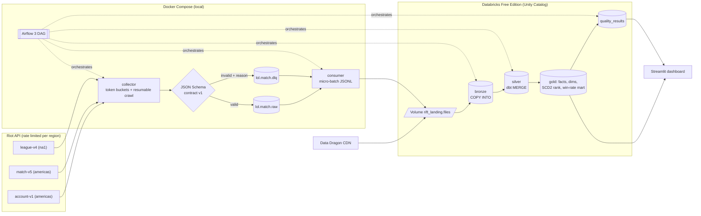

# Rift Lakehouse

An end-to-end League of Legends match data lakehouse built on Riot's own data stack: Python,
Kafka (Redpanda), Databricks (Delta Lake, Unity Catalog, medallion architecture), dbt, Airflow,
and data quality observability.

**The core idea is a data contract enforced at the producer.** Every event is validated against
a versioned JSON Schema *before* it enters Kafka. Valid events go to `lol.match.raw`; invalid
ones go to `lol.match.dlq` with the JSON path that failed, the rule, the schema version, the
time, and the full payload, so they can be replayed after a fix. Riot's re:Invent 2022 talk
described a problem where validation happened too late; this design moves it to the producer.

## Architecture



| Hop | What happens | Why it's idempotent |
|---|---|---|
| Riot → collector | Header-driven token buckets, resumable crawl (SQLite queue) | Fetched match IDs are skipped; complete windows aren't re-listed |
| collector → Kafka | Contract validation → raw or DLQ; idempotent producer, `acks=all` | Deterministic `event_id`; a match is marked fetched only after Kafka acks |
| Kafka → landing | Micro-batches, offsets committed only after files are fsynced | File names come from topic/partition/offsets: re-consuming rewrites the same file |
| landing → Volume | Files API upload (overwrite) then local archive | Same path, same bytes |
| Volume → bronze | `COPY INTO` with raw payload + `_ingested_at`, `_source_file`, `_schema_version` | COPY INTO skips files it already loaded |
| bronze → silver | dbt incremental **MERGE** on natural keys, latest copy wins | Duplicates converge to one row |
| silver → gold | Tables rebuilt; SCD2 snapshot (check strategy) | Deterministic rebuild; unchanged ranks create no new versions |
| quality | Checks MERGE into `quality_results` on (check, date) | Rerunning a date overwrites that date |

## Stack

| Layer | Tool | Version |
|---|---|---|
| Language / tooling | Python, uv, ruff, pytest | 3.12 / 0.10.11 / 0.17.4 / 9.2.0 |
| HTTP | httpx | 0.28.1 |
| Contracts | JSON Schema 2020-12 via jsonschema | 4.26.0 |
| Streaming | Redpanda (Kafka API), confluent-kafka | v26.2.6 / 2.16.1 |
| Warehouse | Databricks Free Edition: Delta Lake, Unity Catalog, serverless SQL warehouse | databricks-sdk 0.117.0 |
| Transformations | dbt-core + dbt-databricks | 1.12.6 / 1.13.0 |
| Orchestration | Apache Airflow (LocalExecutor) | 3.3.2 |
| Dashboard | Streamlit | 1.66.1 |

Every Python dependency is pinned exactly in `pyproject.toml` and locked in `uv.lock`. The
Airflow image installs from the same lockfile into its own virtualenv.

## Setup

Prereqs: Docker Desktop (≥ 4 GB RAM for containers), [uv](https://docs.astral.sh/uv/), a
[Riot developer key](https://developer.riotgames.com), and a
[Databricks Free Edition](https://docs.databricks.com/aws/en/getting-started/free-edition)
workspace with a personal access token.

```bash
cp .env.example .env    # fill in RIOT_API_KEY, DATABRICKS_*, and generate the two Airflow secrets
make setup              # uv sync (pinned)
make lint test          # ruff + pytest
make up                 # Redpanda, Console, Postgres, Airflow; waits until healthy
make check-riot         # one call: HTTP status + your key's live rate limits

# run the pipeline by hand, one hop at a time
make collect START=2026-11-10 END=2026-11-11 MAX_PLAYERS=10 MAX_MATCHES=20
make dlq-peek           # latest DLQ messages with their violations (try `make dlq-demo` first)
make ddragon            # champion metadata
make land               # Kafka -> local JSONL landing files
make bronze-setup       # schemas, Volume, bronze tables (idempotent)
make bronze             # upload to the Volume + COPY INTO
make dbt-build          # silver + gold + snapshot + all dbt tests
make quality DATE=2026-11-10
make dashboard          # http://localhost:8501

# or let Airflow do it
make airflow-config     # .env secrets -> Airflow Connections (Fernet-encrypted), Variables, pool
make backfill START=2026-11-10 END=2026-11-11   # unpauses, waits for the runs, re-pauses
```

| Service | URL |
|---|---|
| Airflow | http://localhost:18080 (local-only login `airflow` / `airflow`) |
| Redpanda Console | http://localhost:18081 |
| Kafka bootstrap | `localhost:19092` (inside Docker: `redpanda:9092`) |

All ports bind to `127.0.0.1`. Run `make help` for every target.

## Design decisions and tradeoffs

**Rate limiting.** One token bucket per (limit, window) pair, per routing host. Capacity B and
refill (L − B)/W are chosen so that B + (L − B) = L: no W-second interval can see more than L
calls, however Riot aligns its windows. A naive bucket (capacity L, refill L/W) can let about 2L
through. Limits are read from `X-App-Rate-Limit` / `X-Method-Rate-Limit`, never hard-coded. The
first response "charges" the calls Riot already counted, so a restarted crawler waits instead of
hitting a 429. 429s honor `Retry-After`. A 429 without `X-Rate-Limit-Type` is a shared service
limit, which gets exponential backoff with jitter. 401/403 fail fast: development keys expire
every 24h. A property test caught a real bug here: a float-precision spin in the wait loop.

**Contracts.** Each schema pins only the fields downstream models use and tolerates Riot's
additive fields. Timeline event types are validated by shape (UPPER_SNAKE), not by a fixed
list, so a new Riot event type flows through and a dbt `accepted_values` test *warns*, instead
of the event being dropped. Rules that depend on event type use `if`/`then`. A test runs real
Riot payloads through the contracts, and it caught a contract stricter than reality:
`teamId: 0` on `DRAGON_SOUL_GIVEN`.

**Timelines as events.** A full timeline is ~0.5 MB and long games exceed Redpanda's 1 MiB
batch limit (verified with `rpk cluster config get kafka_batch_max_bytes`). Each timeline is
exploded into ~1,000 small per-event messages keyed by match ID, so a match's events share a
partition and stay ordered.

**Bronze keeps JSON text.** `payload` is the exact JSON string the producer sent, so bronze
never breaks on schema changes. Typing happens in silver, where `payload:info.gameDuration::int`
and a typed `from_json` struct for participants make the schema explicit and reviewable.

**Airflow 3, not 2.10.** Airflow 2 reached end of life on 2026-04-22. Pinned 3.3.2, the
latest patch of the previous minor, rather than a days-old 3.4.0. One Airflow 3 detail:
`create_cron_data_intervals=False`, so a plain `@daily` has *no* data interval. The DAG uses
`CronDataIntervalTimetable` explicitly. Run IDs are named by `run_after` (the interval *end*),
so `backfill__2026-11-11` processes data day 2026-11-10. Backfill and scheduled runs count
separately against `max_active_runs`, so the tasks that share local state (crawl SQLite,
landing dir, the Riot rate limit) share a size-1 pool, and Databricks tasks share another.
The DAG stays paused by default. `make backfill` unpauses it, waits, and re-pauses so nothing
quietly uses the free quota every day. Pipeline code runs in an isolated venv
(`/opt/rift-venv`) so its pins never fight Airflow's.

**Secrets.** `.env` is gitignored and kept out of the Docker build context (`.dockerignore`
allowlist). Airflow gets secrets as Connections, piped in from `.env` and stored Fernet-encrypted
(verified in the metadata DB), templated into tasks at runtime, and masked in logs. The DAG has
no secrets in it.

**Rank history.** league-v4 only returns the *current* ladder, so SCD2 history is built forward
by snapshotting and can't be backfilled. The snapshot is labeled with the run's logical date, so
reruns are idempotent. Backfills of old dates skip it rather than mislabel today's ladder.

**Win rates need intervals.** The mart reports sample size and a 95% Wilson interval, and the
dashboard ranks champions by the interval's *lower bound*. A 3–0 champion shows [0.44, 1.00],
not "100%". The macro is checked against reference values in a unit test.

**Observability.** Freshness SLO (Delta `DESCRIBE HISTORY` on the gold fact), row volume as a
z-score against a trailing 14-day baseline, game-duration drift as PSI (a parsing bug such as ms
read as s would fail it), and the DLQ rejection rate for the run that collected the day. When
there isn't enough history, checks report `insufficient_data` instead of a fake pass. Any `fail`
exits non-zero, which turns the Airflow task red: that's the alert.

## Results (measured)

Only numbers measured from real runs on 2026-11-11/12 (NA, ranked solo, Challenger +
Grandmaster seeds), each with where it came from.

| Metric | Value | Source |
|---|---|---|
| Matches (silver, distinct) | **641** games played 2026-11-03 → 11-11, 2 patches | `count(*)` on `rift_silver.stg_matches` |
| Participants | 6,410 (exactly 10 per match, dbt-tested) | `rift_silver.stg_participants` |
| Timeline events | **711,284** | `rift_silver.stg_timeline_events` |
| Rank history (SCD2) | 1,261 versions for 1,000 players: 261 LP changes caught between two ladder reads ~2.6 h apart | `rift_gold.snap_player_rank` |
| Contract validation | 713,878 events valid, 0 rejected → **0.00% organic DLQ rate** (3 recorded producer runs) | `sum(valid)`, `sum(rejected)` in `rift_bronze.producer_metrics` |
| Injected DLQ test events | 3 (`make dlq-demo`), excluded from the rate | `rift_bronze.dlq_events` where `_producer = 'dlq-demo'` |
| Duplicates absorbed | 662 match rows in bronze → 641 in silver (21 duplicates from two overlapping runs, removed by the MERGE dedup) | bronze vs silver counts |
| Riot API | 1,257 calls, **0 × 429** for 600 matches in 29.7 min of active time (≈ 20 matches/min) | `data/reports/crawl-20261111T213136Z.json` |
| Pipeline runtime (one Airflow daily run, 20-match day) | **3 min 19 s** end to end: collect 57.7 s · ddragon 2.9 s · consume_and_upload 36.6 s · copy_into_bronze 28.2 s · dbt_build 63.8 s · quality_checks 10.8 s | Airflow task start/end, run `scheduled__2026-11-12` |
| Bulk load | 691,435 Kafka messages → 143 JSONL files (609 MB) in 31.9 s; COPY INTO all six bronze tables ≈ 25 s; rerun inserted **0** rows | consumer report, COPY INTO results |
| dbt | 60/60 (9 models, 1 snapshot, 50 tests) in 57.9 s; rerun 61.8 s with identical row counts | `dbt build` logs |
| Data freshness | **0.01 h** behind at check time (SLO: 26 h) | `rift_quality.quality_results`, `freshness_slo` |
| Quality checks | 2026-11-10: 4/4 pass (volume z = 0.53, duration PSI = 0.094). 2026-11-11: volume **warn**, z = −2.35 (8 matches vs a 79/day mean; the demo run capped collection at 20) and drift `insufficient_data` (8 rows < 30) | `rift_quality.quality_results` |
| Tests | 90 pytest + 50 dbt data tests | `make test`, `dbt build` |

Example from the mart (patch 16.22, TOP, ≥ 20 games): **Kled 40–21, 65.6% win rate, 95% CI
[53.1%, 76.3%]**, ranked first by lower bound out of 22 champions.

## What broke when it ran for real

Unit tests passed before each of these; real data, real services, or a real crash found them.

| Found by | Bug | Fix |
|---|---|---|
| Property test (rate limiter) | A ~1e-16 s wait didn't advance a clock at t≈1000, so `acquire()` spun forever | Explicit float tolerance |
| Real Riot payloads | Contract required `teamId ∈ {100, 200}`, but `DRAGON_SOUL_GIVEN` sends `0` | Allowed `0`, kept 100/200 required on `BUILDING_KILL` |
| Reading Airflow 3 config | Plain `@daily` has no data interval (`create_cron_data_intervals=False`) | `CronDataIntervalTimetable` |
| Rerun analysis | Rerunning a day wrote a new rank snapshot each time | Snapshot labeled with the run's logical date; skipped on backfills |
| Kafka review | Idle timer ran during a group rebalance, so a slow rebalance looked like "no data" | Idle timer starts after partition assignment |
| First Databricks run | Apostrophe in a table comment ended the SQL literal | Shared, tested `sql_string()` escaping |
| First real backfill | Airflow 3 counts backfill and scheduled runs separately, so two runs overlapped and raced on landing files | Size-1 `rift_local` pool + uploader skips taken files |
| Same backfill | Two crawls started in the same second and shared a `run_id`, so one overwrote the other's metrics | Run IDs get a random suffix |

## Limits and next steps

- **Riot development key**: expires every 24h, so unattended daily runs need a personal or
  production key. Throughput is ~0.75 calls/s per region (≈ 22 matches/min), so data volume is
  modest by design.
- **Databricks Free Edition**: serverless only, one 2X-Small warehouse (dbt `threads: 2`, a
  size-1 Airflow pool for Databricks tasks), and an unpublished daily compute quota.
- **Not modeled yet**: timeline `participantFrames` (per-minute gold/xp: needs a fourth
  contract), item and rune dimensions, and DLQ replay tooling (the full payload is already kept
  for it).
- **Single broker**: replication factor 1 is fine locally but not durable. Production would
  use RF=3 with `min.insync.replicas=2`.
- **Alerting**: a failed Airflow task is the alert. Next would be a Slack/email callback and
  a schema-registry-backed contract (Redpanda's registry supports JSON Schema).

## Repo layout

| Path | Purpose |
|---|---|
| `collector/` | Rate limiter, Riot client, resumable crawl, contract registry, Kafka producer, Data Dragon |
| `contracts/v1/` | JSON Schemas: `match`, `timeline_event`, `player_rank` |
| `consumer/` | Kafka → JSONL landing, Volume upload, bronze DDL + COPY INTO |
| `dbt/` | Silver/gold models, SCD2 snapshot, generic + singular tests, docs |
| `dags/` | `rift_lakehouse` Airflow DAG |
| `quality/` | Freshness, volume, drift, DLQ checks → `quality_results` |
| `dashboard/` | Streamlit app over gold |
| `docker/airflow/` | Airflow image and the Connections loader |
| `tests/` | pytest suite (mocked HTTP, fake Kafka, fake clock) |
| `docs/references.md` | Official docs for every tool, and the facts verified against them |
